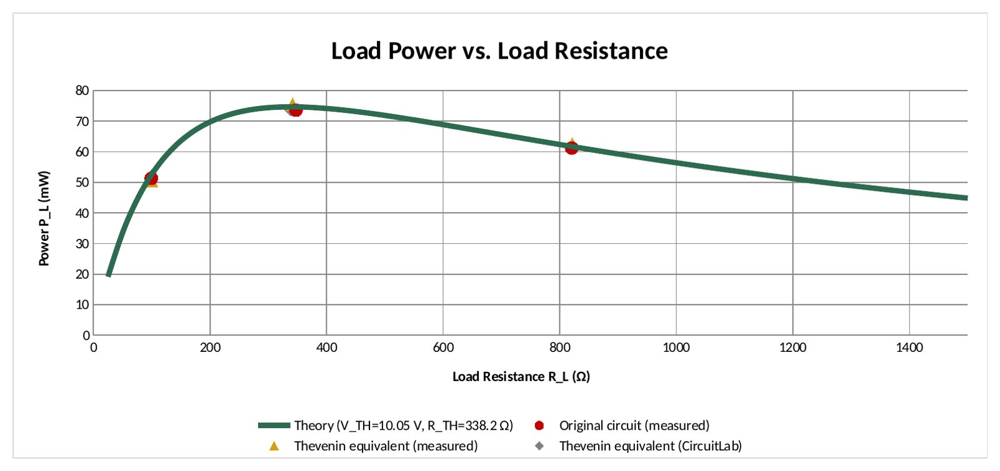
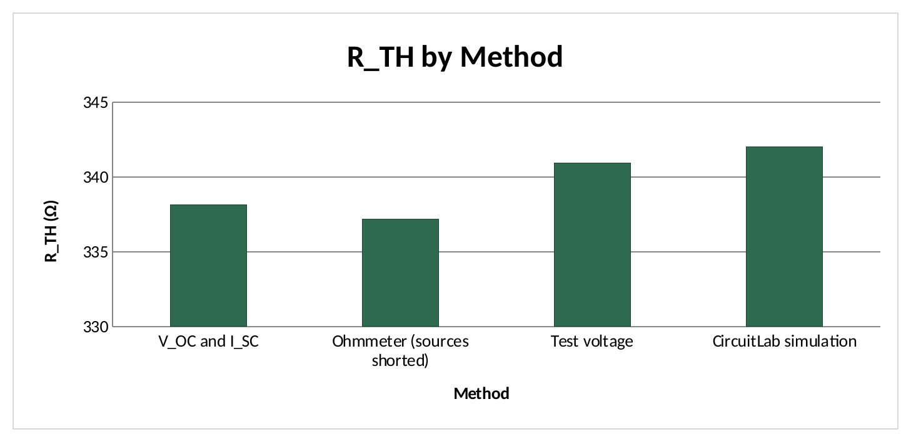
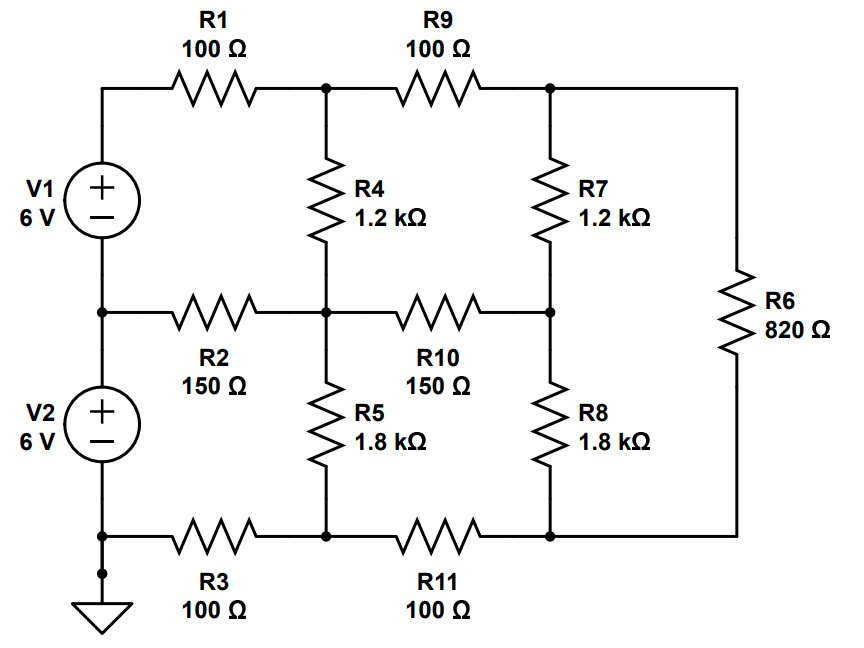
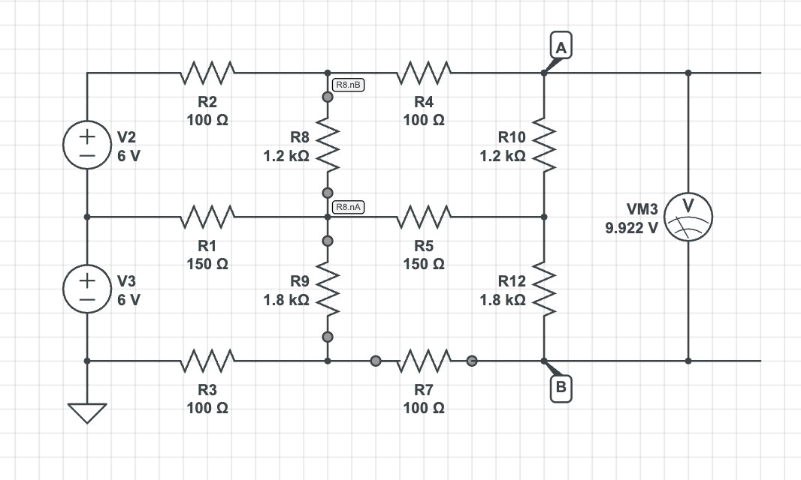
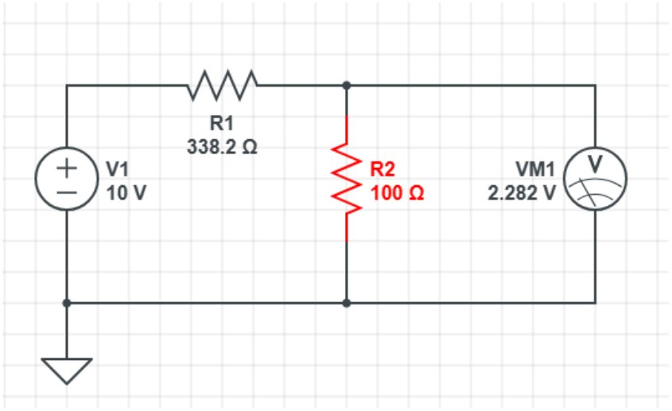
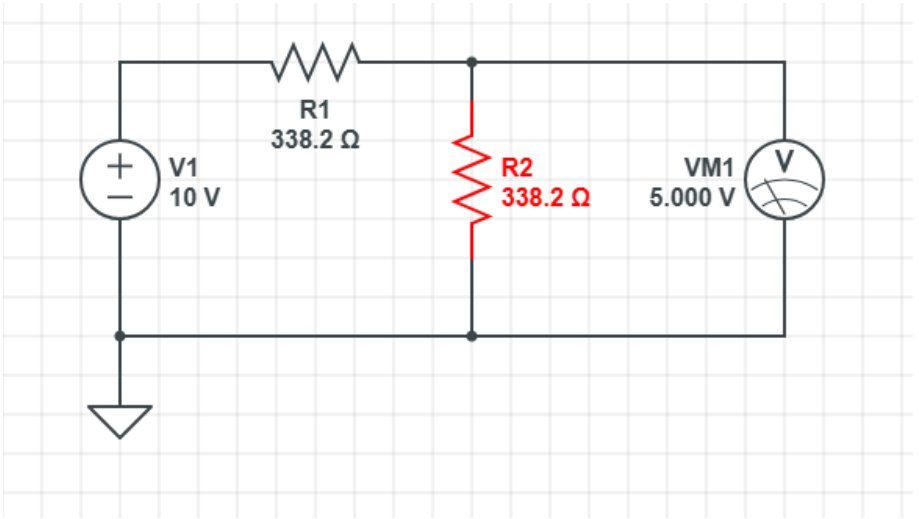
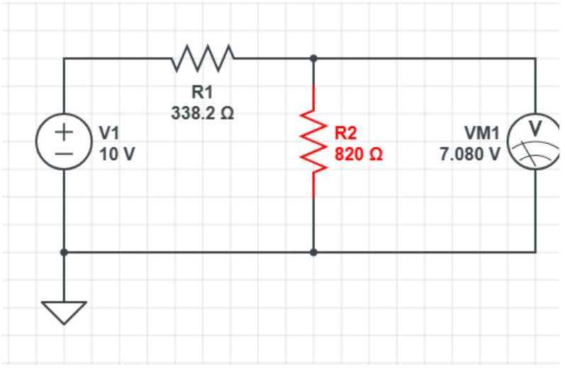

# Thevenin Equivalents and Maximum Power Transfer
**ECE 263 Linear Circuit Theory I · Lab 7 · Valparaiso University · Fall 2026**  
Lab partner: Lesley Osorio

> **Key result:** 73.60 mW to the matched load vs. 74.67 mW theoretical maximum

Replaced a two-source, ten-resistor network with its Thevenin equivalent and tested the maximum power transfer theorem on real hardware.

## What I did

- Measured R_TH three ways: 338.16 Ω (V_OC/I_SC), 337.20 Ω (ohmmeter), and 340.95 Ω (test source), all within 1.1% of each other and 1.5% of the simulated 342.02 Ω.
- Built the equivalent from a supply and series resistors and compared it with the original circuit at three loads; the two agreed within 2.6% at every load.
- The matched load received 73.60 mW, against a theoretical maximum of 74.67 mW.
- Reduced and plotted all data in Excel.

## Report
- 📄 [Full report (PDF)](Guerrero_ECE263_Lab7_Thevenin_Max_Power_Transfer.pdf)
- 📊 [Excel data workbook (PDF)](Guerrero_ECE263_Lab7_Thevenin_Data_Workbook.pdf)

## Figures

### Chart: Load power vs. load resistance: peak at R_L = R_TH

### Chart: R_TH from three measurement methods vs. simulation

### Schematic: Two-source, ten-resistor bridge network

### Schematic: CircuitLab model of the original circuit

### Schematic: Thevenin equivalent with a 100 Ω load

### Schematic: Thevenin equivalent with a matched 338.2 Ω load

### Schematic: Thevenin equivalent with an 820 Ω load

## Tools
Thevenin's theorem, CircuitLab, Excel, DMM

---

**Austin Guerrero** · Electrical Engineering, Valparaiso University (Christ Honors College)  
Portfolio: [austinguerrero.dev](https://austinguerrero.dev) · LinkedIn: [in/guerrero-austin](https://www.linkedin.com/in/guerrero-austin)
